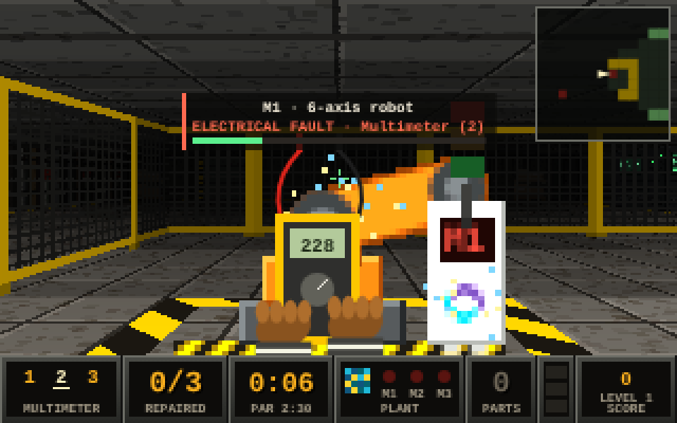
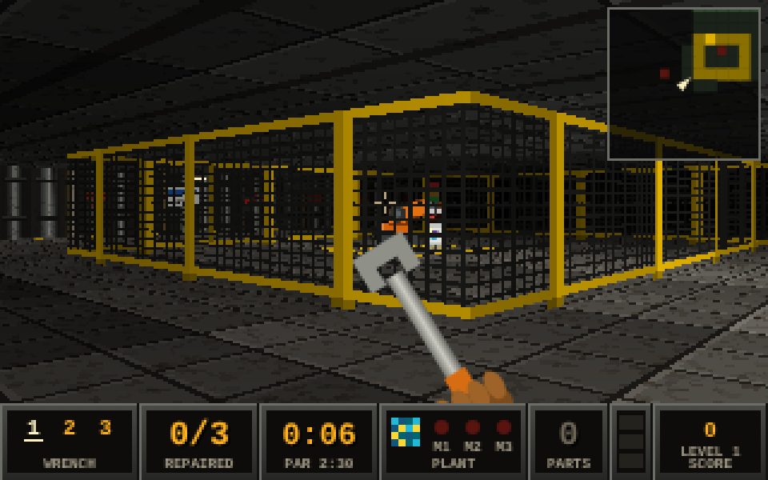

<!-- SPDX-FileCopyrightText: 2026 VISUEL CONCEPT -->
<!-- SPDX-License-Identifier: AGPL-3.0-only -->

# wui-rogue-line — Rogue Line

An original retro first-person game in a plant that is down. A maintenance technician — no
weapons, nothing to fight — repairs its machines with the right tool, keeps off the AGVs' lanes
and gets the line running again, level after level. The machines follow datapoints. Route
`/rogue-line`, element `wui-rogue-line`.

The game is in English only. It is an original game of its genre (first person, corridors,
doors and key cards, a status bar): its name, levels, machines, textures and sounds are its own;
the machines are generic (no maker's name or logo).



## Play

- **Start screen**: nickname (shown in the ranking), difficulty — *Trainee* (quicker repairs,
  slower AGVs), *Technician*, *Night shift* (longer repairs, faster AGVs) — the controls, the
  best technicians. **Start** or Enter.
- **Three levels**, three machines each: *Intake Hall* (M1 6-axis robot, M2 CNC lathe, M3 CNC
  machining centre), *Paint Shop* (an open yard under a smoky dusk, coolant on the floor; M4
  6-axis robot, M5 hydraulic press, M6 conveyor), *Control Core* (M7 6-axis robot, M8 CNC lathe,
  M9 CNC machining centre).
- **Repair**: face the machine, pick its tool, **hold** Space, E or the mouse button: a bar fills
  in 3 s (2 s / 4.5 s by difficulty); stepping away keeps the progress. The fault says the tool:
  **1 Wrench** — mechanical, and a **spare part** found in the level (green crates);
  **2 Multimeter** — electrical; **3 WinCC OA laptop** — software (the recipe reloaded). The
  wrong tool is refused with the right one named.
- **The exit** (`EXIT` panel, use it) opens once every machine of the level runs again.
- **AGVs** shuttle along their lanes with a warning beep: one that bumps the technician pushes
  them aside (−150 points). **Coolant** on the floor slows the walk down.
- **Doors** open on "use"; **key doors** (blue, yellow, red stripe) need their card.
- **Robot cells** are fenced all round: a see-through safety fence (yellow posts, wire mesh), not
  crossable, entered through its **gate** — use it like a door, it slides open.
- **The decor**: stacks of pallets, a yellow safety line along
  the walls, a yellow and black hazard border around each machine, a storage outline under the
  pallets; WinCC OA and Visuel Concept panels on the walls, the Visuel Concept plate on the
  machines.
- **HUD**: the machine in front (its kind, its fault, the tool and part it takes, the repair's
  progress); the **minimap** (top right: the seen plant around, the machines in their state, the
  AGVs); the status bar — tool, machines repaired, time against par, **PLANT** (the level's
  machines: green running, amber stopped, flashing red in fault), spare parts, key cards, score.
  **Tab** / **M**: the full map (every machine shown).
- **Score**: 500 a machine repaired; at the end of a level a bonus for the time under par
  (×10 a second) and +500 without any bump. The summary also shows the **output lost** while
  machines were down (1 part a second per machine in fault). The run's score goes to the ranking
  at the end of the third level, or when the run is left for the menu.

### Controls

| Keyboard / mouse | Gamepad (standard mapping) | Action |
| --- | --- | --- |
| W A S D · Z Q S D | Left stick | Move · strafe |
| Mouse (click the view first) · ← → | Right stick | Turn |
| 1 2 3 · wheel | LB · RB (X wrench, Y multimeter) | Choose the tool |
| Hold Space · E · Enter · left click | Hold A · RT | Repair the machine in front |
| E · Enter · right click | A | Open a door · throw the exit switch |
| Shift | B · L3 | Run |
| Tab · M | Back | Map |
| Esc · P | Start | Pause (mouse sensitivity, turn speed, volume, sound) |

**Touch screens** (phones, tablets; shown only there, while playing): a **joystick** bottom left
(move and strafe, run when pushed to the edge), **drag** anywhere else on the view to turn
(the mouse sensitivity setting applies), bottom right **REPAIR** (hold it), **USE** (doors, the
exit switch) and the three tools, **MAP** and **PAUSE** above them. A phone upright shows the view
at the top and the controls below it. `?touch` in the address shows them with a mouse.

## The plant: machines bound to datapoints

A machine **in fault** flashes red on its stack light, sparks, and keeps the level's exit shut
until it is repaired. The repair happens in the game only: nothing is written to the plant. When
its datapoint goes back to normal and then faults again, the machine has to be repaired again.

`RogueLine_Config.json` (edited in PARA, role `configure`):

```json
{ "machines": [{ "id": 1, "dpe": "Cell1.Robot.State", "run": [1], "fault": [2, 3] }] }
```

`id` is the machine's number (M1 … M9 above). A value is matched against `fault`, then `run`,
then `stop` (lists of values; numbers and booleans compared loosely, strings case-insensitively).
Without lists: true / 1 / "run" → run, false / 0 / "stop" → stop, ≥ 2 / "fault" / "error" /
"défaut" → fault.

**Demo**: without a backend, or with no machine bound, every machine is down at the start of
its level; in a live plant, a machine left unbound is down as in the demo. The start screen
says which plant is used.

## Datapoints

| DP | Type | Written by | Content |
| --- | --- | --- | --- |
| `RogueLine_Config` | `RogueLine_Config` (`.json`) | PARA (admin) | The machines' bindings (above) |
| `RogueLine_Results` | `RogueLine_Results` (`.json`) | the page, at the end of a run | The last 500 runs: id, nickname, score, level reached, all clear, difficulty, time. Nicknames only: no email, no user name |

Both are created on first use through PARA (`DpSingleJsonStore` of wui-kit). Without a backend
they stay in memory: the ranking of the session only.

## Roles (Application Security)

| Role | What it opens |
| --- | --- |
| `play` | The page: playing and adding one's runs to the ranking |
| `configure` | Changing `RogueLine_Config` (declared so that an admin can restrict it; edited in PARA) |

Declared in `libs/wui-rogue-line/src/app-security.roles.json`. Roles are open until an admin
assigns groups.

## Module

- Requires `para` and `app-security` (`wuiPage.requires`): the kit's datapoint stores and the
  role registration. No backend of its own.
- No asset file and no third-party library beyond the shell's: textures, sprites, the floor
  markings and the Visuel Concept panels are drawn at start-up on canvases (the logo from its
  SVG), the sounds are synthesised with WebAudio. Rendering: 320 × 200 pixels scaled up with
  hard edges.
- Source: `rogue-line.ts` (the page, iX), `rogue-line/` — `maps.ts` (levels, pure), `sim.ts`
  (the simulation, pure), `render.ts` (raycaster: a depth per pixel, see-through fences and
  gates; the floor markings), `textures.ts`, `sprites.ts`
  (machines, AGVs, decor), `hud.ts` (tools in hand, target, minimap, status bar), `game.ts` (loop
  and controls), `touch.ts` (the touch controls), `audio.ts`, `plant.ts` (bindings), `results.ts` (ranking, pure).


